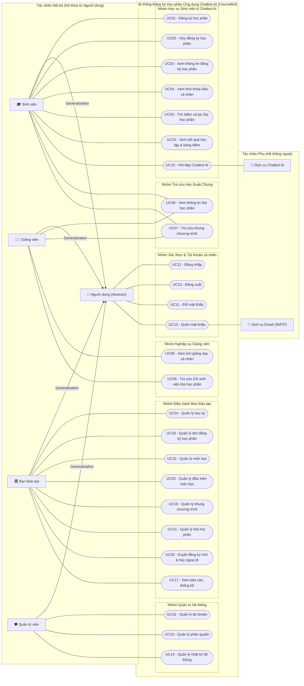
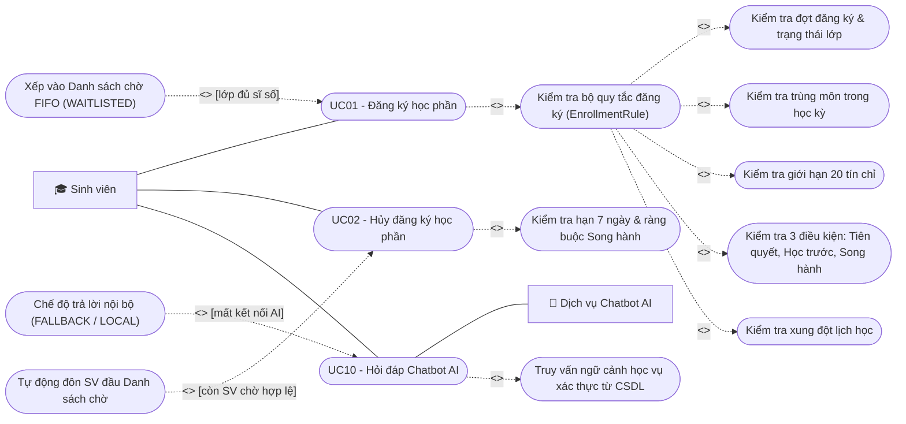

# Đặc tả Yêu cầu Hệ thống (SRS) & Mô hình hóa 26 Use Case — Hệ thống Đăng ký Học phần Ứng dụng Chatbot AI (CourseBot)

> [!IMPORTANT]
> Tài liệu này hoàn thiện trọn vẹn **Việc 5 (Chương 1 — Đặc tả Yêu cầu Hệ thống SRS)** và **Việc 6 (Chương 2 — Biểu đồ Use Case & Đặc tả Chi tiết 26 Use Case)**, đồng bộ 100% với mã nguồn thực tế của hệ thống `CourseBot` (Java 21, Spring Boot 3.5, PostgreSQL / Neon Cloud) và bộ tài liệu gốc tại [`Đặc tả use case.docx`](file:///E:/CODE/PTvTKHDT/%C4%90%E1%BA%B7c%20t%E1%BA%A3%20use%20case.docx).

---

## CHƯƠNG 1. KHẢO SÁT VÀ ĐẶC TẢ YÊU CẦU HỆ THỐNG (SRS — VIỆC 5)

### 1.1. Mục tiêu và Phạm vi Hệ thống

**CourseBot (EduPortal)** là hệ thống quản lý đào tạo tín chỉ trực tuyến tích hợp trợ lý ảo thông minh (**Chatbot AI**), giải quyết bài toán đăng ký học phần tập trung tại các trường đại học đào tạo theo học chế tín chỉ.

**Phạm vi nghiệp vụ cốt lõi của hệ thống bao gồm 5 phân hệ:**
1. **Phân hệ Xác thực & Bảo mật tài khoản**: Đăng nhập phân quyền theo vai trò (RBAC), đăng xuất hủy phiên an toàn, đổi mật khẩu và khôi phục mật khẩu qua mã xác thực **OTP 6 chữ số** gửi tới Email.
2. **Phân hệ Đăng ký học phần & Học vụ Sinh viên**: Tìm kiếm/lọc lớp học phần thời gian thực, kiểm tra tự động chuỗi 6 quy tắc đăng ký (bao gồm đủ 3 loại điều kiện môn học: *Tiên quyết, Học trước, Song hành*), quản lý **Danh sách chờ tự động (FIFO Waitlist)**, hủy học phần có kiểm soát ràng buộc, xem thời khóa biểu cá nhân, tra cứu khung chương trình và xem **Bảng điểm / Kết quả học tập tích lũy**.
3. **Phân hệ Tư vấn Học vụ bằng Chatbot AI**: Tương tác ngôn ngữ tự nhiên kết hợp tra cứu dữ liệu xác thực từ CSDL học vụ (kiến trúc *Verified Academic Context + LLM Adapter*) để giải đáp môn mở, kiểm tra điều kiện học phần, tư vấn lộ trình học tập và gợi ý thời khóa biểu không trùng lịch mà không tự ý can thiệp dữ liệu nghiệp vụ.
4. **Phân hệ Giảng dạy cho Giảng viên**: Xem lịch giảng dạy cá nhân theo học kỳ, tra cứu thông tin lớp học phần, quản lý và xuất danh sách sinh viên lớp học phần.
5. **Phân hệ Điều hành Đào tạo & Quản trị Hệ thống**:
   - *Ban Đào tạo*: Quản lý học kỳ, đợt đăng ký, danh mục môn học, điều kiện môn học, khung chương trình, lớp học phần, báo cáo thống kê sĩ số, **duyệt đăng ký chờ xác nhận (`PENDING`) và hỗ trợ hủy học phần ngoại lệ** khi quá hạn tự hủy.
   - *Quản trị viên*: Quản lý vòng đời tài khoản (tạo mới, cập nhật, khóa/mở khóa, vô hiệu hóa), quản lý phân quyền vai trò và giám sát nhật ký kiểm toán hệ thống (`Audit Log`).

---

### 1.2. Xác định các Tác nhân (Actors) của Hệ thống

Hệ thống gồm **1 tác nhân tổng quát hóa**, **4 tác nhân chính (con người)** và **2 tác nhân phụ (hệ thống bên ngoài)**:

| Mã Actor | Tên Tác nhân | Phân loại | Kế thừa (UML) | Trách nhiệm & Quyền hạn chính trong hệ thống |
| :--- | :--- | :--- | :--- | :--- |
| **ACT-00** | **Người dùng** | Tác nhân tổng quát (*Abstract Actor*) | Cha của `ACT-01..04` | Thực hiện các ca sử dụng chung về tài khoản và phiên làm việc: Đăng nhập (`UC12`), Đăng xuất (`UC23`), Đổi mật khẩu (`UC11`), Quên mật khẩu (`UC13`). |
| **ACT-01** | **Sinh viên** (`STUDENT`) | Tác nhân chính | Kế thừa `Người dùng` | Tra cứu khung chương trình, tìm kiếm/lọc lớp học phần, đăng ký/vào danh sách chờ, hủy đăng ký trong hạn, xem kết quả đăng ký, xem thời khóa biểu cá nhân, xem bảng điểm tích lũy và hỏi đáp tư vấn với Chatbot AI. |
| **ACT-02** | **Giảng viên** (`LECTURER`) | Tác nhân chính | Kế thừa `Người dùng` | Xem lịch giảng dạy cá nhân theo học kỳ, xem chi tiết lớp học phần phụ trách, tra cứu/tìm kiếm và xuất danh sách sinh viên thuộc lớp học phần. |
| **ACT-03** | **Ban Đào tạo** (`TRAINING_OFFICE`) | Tác nhân chính | Kế thừa `Người dùng` | Thiết lập học kỳ, mở/đóng đợt đăng ký, quản lý môn học, cấu hình 3 loại điều kiện môn học, quản lý khung chương trình, mở/cập nhật/hủy lớp học phần, duyệt đăng ký `PENDING`, hủy học phần ngoại lệ sau hạn 7 ngày và xem thống kê báo cáo. |
| **ACT-04** | **Quản trị viên** (`ADMIN`) | Tác nhân chính | Kế thừa `Người dùng` | Quản lý tài khoản người dùng (tạo, sửa, khóa/mở khóa, vô hiệu hóa), cấu hình gán vai trò/phân quyền và tra cứu/xuất nhật ký kiểm toán hoạt động (`Audit Log`). |
| **ACT-05** | **Dịch vụ Chatbot AI** | Tác nhân phụ (*External System*) | Hệ thống ngoài | Tiếp nhận ngữ cảnh học vụ đã kiểm chứng từ Backend qua giao thức HTTP/JSON (`OpenAiCompatibleAiAdapter` cho Gemini/Groq hoặc `TeammateWebhookAiAdapter`) và trả về văn bản diễn giải tư vấn tiếng Việt. |
| **ACT-06** | **Dịch vụ Email (SMTP)** | Tác nhân phụ (*External System*) | Hệ thống ngoài | Tiếp nhận yêu cầu gửi thư điện tử từ Backend qua giao thức SMTP TLS (Gmail SMTP) để chuyển phát mã xác thực OTP 6 chữ số tới hộp thư người dùng khi khôi phục mật khẩu (`UC13`). |

---

### 1.3. Bảng Tổng hợp Danh sách 26 Use Case & Ánh xạ Kiến trúc Mã nguồn

| Mã UC | Tên Use Case | Actor chính | Actor phụ | Phân hệ | Lớp xử lý chính trong Code |
| :--- | :--- | :--- | :--- | :--- | :--- |
| **UC01** | Đăng ký học phần | Sinh viên | Không có | Đăng ký & Học vụ SV | [`EnrollmentService`](file:///e:/CODE/PTvTKHDT/Code%20Project/src/main/java/com/courseregistration/service/EnrollmentService.java), [`EnrollmentRule`](file:///e:/CODE/PTvTKHDT/Code%20Project/src/main/java/com/courseregistration/service/policy/EnrollmentRule.java) |
| **UC02** | Hủy đăng ký học phần | Sinh viên | Không có | Đăng ký & Học vụ SV | [`EnrollmentService`](file:///e:/CODE/PTvTKHDT/Code%20Project/src/main/java/com/courseregistration/service/EnrollmentService.java), [`CourseConditionEvaluator`](file:///e:/CODE/PTvTKHDT/Code%20Project/src/main/java/com/courseregistration/service/policy/CourseConditionEvaluator.java) |
| **UC03** | Xem thông tin đăng ký học phần | Sinh viên | Không có | Đăng ký & Học vụ SV | [`EnrollmentController`](file:///e:/CODE/PTvTKHDT/Code%20Project/src/main/java/com/courseregistration/controller/EnrollmentController.java), [`EnrollmentService`](file:///e:/CODE/PTvTKHDT/Code%20Project/src/main/java/com/courseregistration/service/EnrollmentService.java) |
| **UC04** | Xem thời khóa biểu cá nhân | Sinh viên | Không có | Đăng ký & Học vụ SV | [`CourseService`](file:///e:/CODE/PTvTKHDT/Code%20Project/src/main/java/com/courseregistration/service/CourseService.java), [`dashboard.js`](file:///e:/CODE/PTvTKHDT/Code%20Project/src/main/resources/static/assets/js/features/student/dashboard.js) |
| **UC05** | Tìm kiếm và lọc lớp học phần | Sinh viên | Không có | Đăng ký & Học vụ SV | [`CourseController`](file:///e:/CODE/PTvTKHDT/Code%20Project/src/main/java/com/courseregistration/controller/CourseController.java), [`CourseService`](file:///e:/CODE/PTvTKHDT/Code%20Project/src/main/java/com/courseregistration/service/CourseService.java) |
| **UC06** | Xem thông tin lớp học phần | Sinh viên, Giảng viên | Không có | Tra cứu chung | [`CourseService`](file:///e:/CODE/PTvTKHDT/Code%20Project/src/main/java/com/courseregistration/service/CourseService.java), [`WorkspaceService`](file:///e:/CODE/PTvTKHDT/Code%20Project/src/main/java/com/courseregistration/service/WorkspaceService.java) |
| **UC07** | Tra cứu khung chương trình | Sinh viên, Giảng viên | Không có | Tra cứu chung | [`StudentAcademicService`](file:///e:/CODE/PTvTKHDT/Code%20Project/src/main/java/com/courseregistration/service/StudentAcademicService.java) |
| **UC08** | Xem lịch giảng dạy cá nhân | Giảng viên | Không có | Phân hệ Giảng viên | [`WorkspaceController`](file:///e:/CODE/PTvTKHDT/Code%20Project/src/main/java/com/courseregistration/controller/WorkspaceController.java), [`WorkspaceService`](file:///e:/CODE/PTvTKHDT/Code%20Project/src/main/java/com/courseregistration/service/WorkspaceService.java) |
| **UC09** | Tra cứu danh sách sinh viên trong lớp học phần | Giảng viên | Không có | Phân hệ Giảng viên | [`WorkspaceController`](file:///e:/CODE/PTvTKHDT/Code%20Project/src/main/java/com/courseregistration/controller/WorkspaceController.java), [`WorkspaceService`](file:///e:/CODE/PTvTKHDT/Code%20Project/src/main/java/com/courseregistration/service/WorkspaceService.java) |
| **UC10** | Hỏi đáp Chatbot AI | Sinh viên | Dịch vụ Chatbot AI | Tư vấn Chatbot AI | [`ChatbotService`](file:///e:/CODE/PTvTKHDT/Code%20Project/src/main/java/com/courseregistration/service/ChatbotService.java), [`AcademicChatService`](file:///e:/CODE/PTvTKHDT/Code%20Project/src/main/java/com/courseregistration/service/AcademicChatService.java), [`AiProviderAdapter`](file:///e:/CODE/PTvTKHDT/Code%20Project/src/main/java/com/courseregistration/service/chat/AiProviderAdapter.java) |
| **UC11** | Đổi mật khẩu | Người dùng | Không có | Xác thực & Tài khoản | [`AuthController`](file:///e:/CODE/PTvTKHDT/Code%20Project/src/main/java/com/courseregistration/controller/AuthController.java), [`AuthService`](file:///e:/CODE/PTvTKHDT/Code%20Project/src/main/java/com/courseregistration/service/AuthService.java) |
| **UC12** | Đăng nhập | Người dùng | Không có | Xác thực & Tài khoản | [`SecurityConfig`](file:///e:/CODE/PTvTKHDT/Code%20Project/src/main/java/com/courseregistration/config/SecurityConfig.java), [`AuthController`](file:///e:/CODE/PTvTKHDT/Code%20Project/src/main/java/com/courseregistration/controller/AuthController.java) |
| **UC13** | Quên mật khẩu | Người dùng | Dịch vụ Email (SMTP) | Xác thực & Tài khoản | [`PasswordResetController`](file:///e:/CODE/PTvTKHDT/Code%20Project/src/main/java/com/courseregistration/controller/PasswordResetController.java), [`PasswordResetService`](file:///e:/CODE/PTvTKHDT/Code%20Project/src/main/java/com/courseregistration/service/PasswordResetService.java) |
| **UC14** | Quản lý nhật ký hệ thống | Quản trị viên | Không có | Quản trị Hệ thống | [`AdminManagementController`](file:///e:/CODE/PTvTKHDT/Code%20Project/src/main/java/com/courseregistration/controller/AdminManagementController.java), [`AuditService`](file:///e:/CODE/PTvTKHDT/Code%20Project/src/main/java/com/courseregistration/service/AuditService.java) |
| **UC15** | Quản lý phân quyền | Quản trị viên | Không có | Quản trị Hệ thống | [`AdminManagementService`](file:///e:/CODE/PTvTKHDT/Code%20Project/src/main/java/com/courseregistration/service/AdminManagementService.java), [`SecurityConfig`](file:///e:/CODE/PTvTKHDT/Code%20Project/src/main/java/com/courseregistration/config/SecurityConfig.java) |
| **UC16** | Quản lý tài khoản | Quản trị viên | Không có | Quản trị Hệ thống | [`AdminManagementController`](file:///e:/CODE/PTvTKHDT/Code%20Project/src/main/java/com/courseregistration/controller/AdminManagementController.java), [`AdminManagementService`](file:///e:/CODE/PTvTKHDT/Code%20Project/src/main/java/com/courseregistration/service/AdminManagementService.java) |
| **UC17** | Xem báo cáo, thống kê | Ban Đào tạo | Không có | Điều hành Đào tạo | [`WorkspaceService`](file:///e:/CODE/PTvTKHDT/Code%20Project/src/main/java/com/courseregistration/service/WorkspaceService.java), [`TrainingManagementService`](file:///e:/CODE/PTvTKHDT/Code%20Project/src/main/java/com/courseregistration/service/TrainingManagementService.java) |
| **UC18** | Quản lý đợt đăng ký học phần | Ban Đào tạo | Không có | Điều hành Đào tạo | [`TrainingManagementController`](file:///e:/CODE/PTvTKHDT/Code%20Project/src/main/java/com/courseregistration/controller/TrainingManagementController.java), [`TrainingManagementService`](file:///e:/CODE/PTvTKHDT/Code%20Project/src/main/java/com/courseregistration/service/TrainingManagementService.java) |
| **UC19** | Quản lý khung chương trình | Ban Đào tạo | Không có | Điều hành Đào tạo | [`TrainingManagementService`](file:///e:/CODE/PTvTKHDT/Code%20Project/src/main/java/com/courseregistration/service/TrainingManagementService.java) |
| **UC20** | Quản lý điều kiện môn học (Tiên quyết / Học trước / Song hành) | Ban Đào tạo | Không có | Điều hành Đào tạo | [`TrainingManagementService`](file:///e:/CODE/PTvTKHDT/Code%20Project/src/main/java/com/courseregistration/service/TrainingManagementService.java), [`CourseCondition`](file:///e:/CODE/PTvTKHDT/Code%20Project/src/main/java/com/courseregistration/entity/CourseCondition.java) |
| **UC21** | Quản lý lớp học phần | Ban Đào tạo | Không có | Điều hành Đào tạo | [`TrainingManagementController`](file:///e:/CODE/PTvTKHDT/Code%20Project/src/main/java/com/courseregistration/controller/TrainingManagementController.java), [`TrainingManagementService`](file:///e:/CODE/PTvTKHDT/Code%20Project/src/main/java/com/courseregistration/service/TrainingManagementService.java) |
| **UC22** | Quản lý môn học | Ban Đào tạo | Không có | Điều hành Đào tạo | [`TrainingManagementController`](file:///e:/CODE/PTvTKHDT/Code%20Project/src/main/java/com/courseregistration/controller/TrainingManagementController.java), [`TrainingManagementService`](file:///e:/CODE/PTvTKHDT/Code%20Project/src/main/java/com/courseregistration/service/TrainingManagementService.java) |
| **UC23** | Đăng xuất | Người dùng | Không có | Xác thực & Tài khoản | [`SecurityConfig`](file:///e:/CODE/PTvTKHDT/Code%20Project/src/main/java/com/courseregistration/config/SecurityConfig.java), [`AuthController`](file:///e:/CODE/PTvTKHDT/Code%20Project/src/main/java/com/courseregistration/controller/AuthController.java) |
| **UC24** | Quản lý học kỳ | Ban Đào tạo | Không có | Điều hành Đào tạo | [`TrainingManagementController`](file:///e:/CODE/PTvTKHDT/Code%20Project/src/main/java/com/courseregistration/controller/TrainingManagementController.java), [`Semester`](file:///e:/CODE/PTvTKHDT/Code%20Project/src/main/java/com/courseregistration/entity/Semester.java) |
| **UC25** *(Mới)* | **Xem kết quả học tập và bảng điểm tích lũy** | Sinh viên | Không có | Đăng ký & Học vụ SV | [`StudentAcademicController`](file:///e:/CODE/PTvTKHDT/Code%20Project/src/main/java/com/courseregistration/controller/StudentAcademicController.java), [`StudentAcademicService`](file:///e:/CODE/PTvTKHDT/Code%20Project/src/main/java/com/courseregistration/service/StudentAcademicService.java) |
| **UC26** *(Mới)* | **Duyệt đăng ký chờ xác nhận và hủy học phần ngoại lệ** | Ban Đào tạo | Không có | Điều hành Đào tạo | [`TrainingManagementController`](file:///e:/CODE/PTvTKHDT/Code%20Project/src/main/java/com/courseregistration/controller/TrainingManagementController.java), [`TrainingManagementService`](file:///e:/CODE/PTvTKHDT/Code%20Project/src/main/java/com/courseregistration/service/TrainingManagementService.java) |

---

### 1.4. Các Quy tắc Nghiệp vụ Cốt lõi (Business Rules)

| Mã quy tắc | Tên quy tắc | Nội dung chi tiết áp dụng trong hệ thống |
| :--- | :--- | :--- |
| **BR-01** | Thời hạn đợt đăng ký | Sinh viên chỉ được đăng ký mới khi học kỳ đang có đợt đăng ký ở trạng thái `OPEN` nằm trong khoảng `[startsAt, endsAt]` (hoặc học kỳ bật cờ mở đăng ký thử nghiệm). Lớp học phần phải ở trạng thái `OPEN` và không bị gắn cờ rà soát lịch. |
| **BR-02** | Không đăng ký trùng môn | Trong cùng một học kỳ, sinh viên không được đăng ký lặp lại cùng một lớp học phần hoặc đăng ký hai lớp học phần khác nhau của cùng một mã môn học. |
| **BR-03** | Giới hạn tín chỉ tối đa | Tổng số tín chỉ đã đăng ký (`ENROLLED`) cộng với số tín chỉ của học phần dự kiến đăng ký trong học kỳ không được vượt quá **20 tín chỉ** (cấu hình mặc định `app.enrollment.max-credits=20`). |
| **BR-04** | Bộ 3 điều kiện môn học | Khi đăng ký học phần `A`, hệ thống kiểm tra đủ cả 3 loại ràng buộc học vụ: (1) **Tiên quyết (`PREREQUISITE`)**: bắt buộc đã học và đạt (`passed = true`, điểm hệ 10 ≥ 4.0) môn `B`; (2) **Học trước (`PREVIOUS`)**: đã từng có kết quả học tập môn `B` ở kỳ trước (kể cả chưa đạt); (3) **Song hành (`COREQUISITE`)**: đã đạt môn `B` trước đó hoặc đang đăng ký môn `B` đồng thời trong cùng học kỳ. |
| **BR-05** | Chống xung đột lịch học | Không cho phép đăng ký hai lớp học phần trùng thứ trong tuần và giao nhau về ca/tiết học trong cùng một học kỳ. |
| **BR-06** | Danh sách chờ tự động (FIFO Waitlist) | Nếu sinh viên thỏa mãn toàn bộ `BR-01..BR-05` nhưng sĩ số lớp đã chạm trần (`totalEnrolled >= capacity`), hệ thống không từ chối cứng mà tự động ghi nhận vào **Danh sách chờ (`WaitlistEntry - WAITING`)** theo thứ tự thời gian đến trước phục vụ trước (FIFO). Khi lớp có ghế trống, sinh viên đầu tiên trong hàng chờ còn thỏa mãn điều kiện học vụ sẽ tự động được đôn lên `ENROLLED`. |
| **BR-07** | Hạn tự hủy 7 ngày & Chặn hủy ngược môn Song hành | Sinh viên chỉ được tự hủy lớp học phần trong vòng **7 ngày đầu kể từ ngày bắt đầu học kỳ** (`drop-window-days=7`), và hệ thống từ chối hủy nếu môn định hủy đang là điều kiện **Song hành (`COREQUISITE`)** bắt buộc của một môn khác mà sinh viên vẫn đang giữ trong kỳ. Sau mốc 7 ngày, chỉ **Ban Đào tạo** mới được thực hiện hủy học phần ngoại lệ (`UC26`). |
| **BR-08** | Duyệt đăng ký chờ xác nhận (`PENDING`) | Các bản ghi đăng ký ở trạng thái `PENDING` (chờ xác nhận học vụ) do Ban Đào tạo xem xét phê duyệt chuyển sang `ENROLLED` (sau khi kiểm tra còn chỗ trống) hoặc từ chối chuyển sang `CANCELLED` kèm ghi chú nhật ký kiểm toán. |
| **BR-09** | Nguyên tắc an toàn Chatbot AI (Verified RAG + Read-Only) | Chatbot AI **chỉ tư vấn, tuyệt đối không tự ý ghi/sửa/xóa bản ghi đăng ký**. Mọi câu hỏi về tín chỉ, lịch học, điểm số, điều kiện môn đều phải được Backend truy vấn chính xác từ CSDL trước khi gửi cho mô hình AI diễn đạt. Khi dịch vụ AI bên ngoài mất kết nối, hệ thống tự động chuyển về chế độ `FALLBACK` / `LOCAL` để trả về câu trả lời dữ liệu gốc. |
| **BR-10** | An toàn khôi phục mật khẩu OTP | Mã xác thực khôi phục mật khẩu gồm **6 chữ số ngẫu nhiên**, chỉ lưu bản băm `SHA-256` trong CSDL, có hiệu lực tối đa **10 phút**, chỉ dùng một lần và tự động khóa mã nếu nhập sai liên tiếp **5 lần**. |

---

### 1.5. Đặc tả Yêu cầu Phi chức năng (Non-Functional Requirements)

| Mã NFR | Nhóm yêu cầu | Đặc tả tiêu chí kỹ thuật & chất lượng |
| :--- | :--- | :--- |
| **NFR-01** | **Bảo mật & Phân quyền (Security)** | Mật khẩu băm một chiều bằng `BCrypt`; phân quyền chặt chẽ ở tầng URL và phương thức bằng `Spring Security` cho 4 vai trò (`STUDENT`, `LECTURER`, `TRAINING_OFFICE`, `ADMIN`); bật bảo vệ `CSRF` cho các thao tác thay đổi trạng thái; giới hạn tần suất gọi Chatbot AI tối đa **20 yêu cầu/phút/phiên** chống lạm dụng tài nguyên. |
| **NFR-02** | **Toàn vẹn đồng thời & Giao dịch (Concurrency & ACID)** | Các thao tác nhạy cảm về sĩ số (`enroll`, `drop`, `approve`, `adminDrop`) chạy trong giao dịch `@Transactional` kết hợp khóa bi quan (`PESSIMISTIC_WRITE` qua `findSectionForUpdate`) đảm bảo không bao giờ vượt sĩ số tối đa khi nhiều sinh viên bấm đăng ký cùng lúc. |
| **NFR-03** | **Độ tin cậy & Khả năng chịu lỗi (Reliability & Fallback)** | Thiết lập timeout kết nối 3 giây và đọc tối đa 12–30 giây khi gọi API AI bên ngoài; khi mạng hoặc nhà cung cấp AI gặp sự cố, hệ thống không báo lỗi sập trang (HTTP 500) mà chuyển mượt sang chế độ `FALLBACK` trả kết quả học vụ nội bộ trong dưới 500ms. |
| **NFR-04** | **Khả năng mở rộng & Bảo trì (Maintainability & OOP Design Patterns)** | Tuân thủ kiến trúc phân tầng (`Controller -> Service -> Repository -> Entity`); áp dụng **Strategy Pattern** (`EnrollmentRule`) để thêm/bớt quy tắc kiểm tra đăng ký mà không sửa lớp lõi, và **Adapter Pattern** (`AiProviderAdapter`) để hoán đổi linh hoạt giữa Gemini, Groq, OpenAI hoặc Webhook Chatbot riêng của thành viên nhóm chỉ qua biến cấu hình `.env`. |
| **NFR-05** | **Khả năng kiểm toán (Auditability)** | Mọi sự kiện quan trọng (đăng ký, vào hàng chờ, tự động đôn chỗ, hủy môn, duyệt/từ chối `PENDING`, mở học kỳ, khóa tài khoản, đổi phân quyền) đều tự động lưu vết vào bảng `audit_logs` kèm người thực hiện và dấu thời gian. |
| **NFR-06** | **Tính khả dụng & Triển khai đa môi trường (Portability & Usability)** | Giao diện Web tiếng Việt trực quan, đáp ứng tốt trên máy tính và thiết bị di động; hỗ trợ chạy đồng nhất trên cả PostgreSQL cục bộ lẫn Cloud PostgreSQL (Neon Serverless SSL) với bộ 46 bài kiểm thử tự động JUnit 5 đạt 100%. |

---

## CHƯƠNG 2. HỆ THỐNG BIỂU ĐỒ USE CASE & CHUẨN HÓA 26 ĐẶC TẢ (VIỆC 6)

### 2.1. Rà soát Sơ đồ Visual Paradigm hiện có & Hướng dẫn Chỉnh chuẩn UML 10/10

> [!WARNING]
> Trong thư mục [`Sơ đồ/`](file:///E:/CODE/PTvTKHDT/S%C6%A1%20%C4%91%E1%BB%93) hiện có 2 bản vẽ tổng quát: [`Use Case Tổng Quát.jpg`](file:///E:/CODE/PTvTKHDT/S%C6%A1%20%C4%91%E1%BB%93/Use%20Case%20T%E1%BB%95ng%20Qu%C3%A1t.jpg) và [`Use_Case_Tong_Quat .jpg`](file:///E:/CODE/PTvTKHDT/S%C6%A1%20%C4%91%E1%BB%93/Use_Case_Tong_Quat%20.jpg).
> **Tuyệt đối KHÔNG đưa bản `Use_Case_Tong_Quat .jpg` vào báo cáo** vì bản đó mắc 2 lỗi UML kinh điển: (1) Cho `Phòng đào tạo ──▷ Giảng viên ──▷ Sinh viên` (nghĩa là Phòng đào tạo kế thừa cả chức năng đi đăng ký học của Sinh viên!) và (2) nối `<<include>> Đăng nhập` từ mọi Use Case (Đăng nhập là *Tiền điều kiện*, không phải `<<include>>`).
> **Hãy dùng bản [`Use Case Tổng Quát.jpg`](file:///E:/CODE/PTvTKHDT/S%C6%A1%20%C4%91%E1%BB%93/Use%20Case%20T%E1%BB%95ng%20Qu%C3%A1t.jpg)** — bản này đã vẽ đúng kế thừa `Người dùng` và rất sạch! Bạn chỉ cần mở Visual Paradigm chỉnh nhẹ **5 điểm nhỏ** sau là đạt điểm tối đa:
> 1. Kẻ thêm mũi tên kế thừa (`Generalization ──▷`) từ **`Quản trị viên`** về **`Người dùng`** (giống hệt `Sinh viên`, `Giảng viên`, `Ban đào tạo`).
> 2. Thêm `UC23 – Đăng xuất` nối với **`Người dùng`**; thêm `UC25 – Xem kết quả học tập` nối với **`Sinh viên`**; thêm `UC24 – Quản lý học kỳ` và `UC26 – Duyệt đăng ký & hủy ngoại lệ` nối với **`Ban đào tạo`**.
> 3. Xóa hình oval bị lặp `Xem chi tiết lớp học phần` và nối cả `Sinh viên` lẫn `Giảng viên` vào chung 1 oval duy nhất **`Xem thông tin lớp học phần`** (`UC06`).
> 4. Xóa đường nối nhầm từ `Giảng viên` sang `Hỏi đáp chat bot` (chỉ `Sinh viên` nối với `UC10 – Hỏi đáp Chatbot AI`).
> 5. Bên phải khung hệ thống: Đổi tên Actor `Chat bot` thành **`Dịch vụ Chatbot AI`** và thêm Actor phụ thứ hai **`Dịch vụ Email (SMTP)`** nối vào `UC13 – Quên mật khẩu`.

---

### 2.2. Mô hình Biểu đồ Use Case Tổng quát & Phân rã chuẩn UML

#### A. Biểu đồ Use Case Tổng quát (26 Use Case & 7 Tác nhân)

#### B. Biểu đồ Phân rã Quan hệ `<<include>>` & `<<extend>>` cho Cụm Đăng ký – Hủy – Chatbot AI

---

### 2.3. Tóm tắt các Điểm Đã Chuẩn hóa ở `UC01`, `UC02`, `UC10`, `UC20` & Toàn văn `UC25`, `UC26`

> [!TIP]
> Toàn bộ **26 Use Case (`UC01` -> `UC26`)** đầy đủ chữ và bảng đã được xuất trực tiếp thành file Word chuẩn định dạng Times New Roman 13pt tại [`Bao_cao_Chuong1_SRS_va_Chuong2_Dac_ta_26_UseCase.docx`](file:///E:/CODE/PTvTKHDT/Bao_cao_Chuong1_SRS_va_Chuong2_Dac_ta_26_UseCase.docx) (không ghi đè lên file gốc của bạn). Dưới đây là chi tiết 2 Use Case viết mới (`UC25`, `UC26`) và các điểm đã nâng cấp khớp code:

- **Các điểm đã nâng cấp trong `UC01, UC02, UC10, UC20`**:
  - **`UC01`**: Kiểm tra đủ 3 loại điều kiện môn học (*Tiên quyết, Học trước, Song hành*), giới hạn 20 tín chỉ/kỳ, và cập nhật nhánh `A12.1 – Lớp đã đủ sĩ số` sang tự động ghi nhận vào **Danh sách chờ (`WAITLISTED`)** theo thứ tự FIFO kèm vị trí chờ.
  - **`UC02`**: Xóa bỏ hoàn toàn câu nhắc nhở nháp ở nhánh `A9.1`, thay bằng nhánh **`A9.1 – Vi phạm ràng buộc môn Song hành`** (từ chối hủy nếu môn này đang là môn song hành bắt buộc của một học phần khác đang học trong kỳ); ghi rõ hạn **7 ngày đầu học kỳ** ở `A8.1` và bổ sung bước tự động đôn sinh viên đầu hàng chờ (`WAITLISTED -> ENROLLED`) khi có ghế trống.
  - **`UC10`**: Cập nhật nhánh `A6.1` theo đúng kiến trúc `ONLINE -> FALLBACK -> LOCAL`: nếu dịch vụ AI bên ngoài không phản hồi hoặc chưa cấu hình khóa API, hệ thống vẫn phục vụ ngay câu trả lời xác thực từ CSDL học vụ nội bộ.
  - **`UC20`**: Chuẩn hóa thành **Quản lý điều kiện môn học (Tiên quyết, Học trước, Song hành)** để đồng bộ với bảng `course_conditions` trên CSDL.

---

#### Toàn văn Đặc tả `UC25 – Xem kết quả học tập và bảng điểm tích lũy`

| Thuộc tính | Nội dung |
| :--- | :--- |
| **Mã Use Case** | UC25 |
| **Tên Use Case** | Xem kết quả học tập và bảng điểm tích lũy |
| **Mô tả sơ lược** | Cho phép sinh viên tra cứu toàn bộ điểm học phần qua các học kỳ, theo dõi tổng số tín chỉ tích lũy, điểm trung bình học tập tham chiếu (hệ 10), số môn đạt/chưa đạt, lọc kết quả theo học kỳ hoặc từ khóa và xuất bảng điểm ra file CSV. |
| **Actor chính** | Sinh viên |
| **Actor phụ** | Không có |
| **Trigger** | Sinh viên chọn mục “Kết quả học tập / Bảng điểm” trên cổng thông tin Sinh viên. |
| **Tiền điều kiện (Pre-condition)** | Sinh viên đã đăng nhập thành công bằng tài khoản hợp lệ. Hệ thống đã có dữ liệu hồ sơ sinh viên. |
| **Hậu điều kiện (Post-condition)** | Hệ thống hiển thị bảng điểm chi tiết và các chỉ số tổng hợp chính xác (tự động loại trùng tín chỉ đối với các học phần học lại/cải thiện). Dữ liệu kết quả học tập trong CSDL không bị thay đổi. |

**Luồng sự kiện chính – Main Flow (`UC25`):**

| Tác nhân – Sinh viên | Hệ thống |
| :--- | :--- |
| 1. Sinh viên chọn chức năng “Kết quả học tập / Bảng điểm”. | 2. Hệ thống xác định hồ sơ sinh viên hiện tại và truy vấn danh sách kết quả học tập qua các học kỳ từ CSDL. |
| | 3. Hệ thống tính toán các chỉ số tổng hợp gồm: tổng tín chỉ tích lũy (không tính trùng môn học lại), điểm trung bình tích lũy tham chiếu hệ 10 có trọng số tín chỉ, số môn đạt và số môn chưa đạt/học lại. |
| | 4. Hệ thống hiển thị thẻ tổng quan kết quả học tập và bảng điểm chi tiết (học kỳ, mã môn, tên môn, số tín chỉ, điểm hệ 10, điểm chữ, trạng thái đạt/chưa đạt, ghi chú học lại). |
| 5. Sinh viên có thể chọn lọc theo học kỳ, trạng thái (Tất cả / Đạt / Chưa đạt) hoặc nhập từ khóa mã môn, tên môn. | 6. Hệ thống lọc và cập nhật danh sách các dòng điểm phù hợp ngay trên giao diện. |
| 7. Sinh viên có thể chọn nút “Xuất bảng điểm CSV”. | 8. Hệ thống kết xuất dữ liệu bảng điểm hiện tại thành tệp CSV mã hóa chuẩn UTF-8 để tải về máy. |
| 9. Sinh viên xem thông tin và hoàn tất tra cứu. | 10. Kết thúc use case. |

**Luồng sự kiện thay thế – Alternate Flow (`UC25`):**

| Mã nhánh | Luồng thay thế |
| :--- | :--- |
| **A2.1 – Sinh viên khóa mới chưa có điểm** | Tại bước 2, nếu sinh viên chưa có bất kỳ bản ghi kết quả học tập nào từ các học kỳ trước, hệ thống hiển thị các chỉ số tổng hợp bằng 0 và thông báo “Chưa có dữ liệu kết quả học tập được công bố”. Use case kết thúc. |
| **A3.1 – Có học phần học lại hoặc cải thiện điểm** | Tại bước 3, nếu một mã môn xuất hiện ở nhiều học kỳ, hệ thống gắn nhãn “Lần học thứ N”, chỉ cộng tín chỉ tích lũy một lần duy nhất khi đã đạt và sử dụng điểm cao nhất đã đạt để tính GPA tham chiếu. |
| **A6.1 – Không có môn phù hợp bộ lọc** | Tại bước 6, nếu tiêu chí lọc không khớp bản ghi nào, hệ thống hiển thị bảng trống kèm thông báo “Không tìm thấy học phần phù hợp với bộ lọc”. Sinh viên có thể đặt lại bộ lọc. |
| **A8.1 – Xuất tệp CSV thất bại** | Tại bước 8, nếu trình duyệt hoặc quá trình tạo tệp gặp sự cố, hệ thống thông báo “Không thể xuất tệp bảng điểm, vui lòng thử lại”. |

---

#### Toàn văn Đặc tả `UC26 – Duyệt đăng ký chờ xác nhận và hủy học phần ngoại lệ`

| Thuộc tính | Nội dung |
| :--- | :--- |
| **Mã Use Case** | UC26 |
| **Tên Use Case** | Duyệt đăng ký chờ xác nhận và hủy học phần ngoại lệ |
| **Mô tả sơ lược** | Cho phép cán bộ Ban Đào tạo rà soát, phê duyệt hoặc từ chối các bản ghi đăng ký ở trạng thái chờ xác nhận (`PENDING`), đồng thời hỗ trợ hủy học phần ngoại lệ (`adminDrop`) cho sinh viên khi đã quá thời hạn tự hủy 7 ngày đầu học kỳ kèm cơ chế tự động đôn danh sách chờ. |
| **Actor chính** | Ban Đào tạo |
| **Actor phụ** | Không có |
| **Trigger** | Cán bộ Ban Đào tạo chọn chức năng “Duyệt & Hủy đăng ký” trên cổng điều hành Đào tạo. |
| **Tiền điều kiện (Pre-condition)** | Người dùng đã đăng nhập bằng tài khoản vai trò Ban Đào tạo (`TRAINING_OFFICE`) hoặc Quản trị viên được cấp quyền. |
| **Hậu điều kiện (Post-condition)** | Thành công: trạng thái bản ghi đăng ký được cập nhật (`ENROLLED` hoặc `CANCELLED`), sĩ số lớp và danh sách chờ (nếu có chỗ trống) được đồng bộ, thao tác được ghi nhận vào nhật ký kiểm toán (`Audit Log`). Thất bại: dữ liệu giữ nguyên như ban đầu. |

**Luồng sự kiện chính – Main Flow (`UC26`):**

| Tác nhân – Ban Đào tạo | Hệ thống |
| :--- | :--- |
| 1. Cán bộ Ban Đào tạo chọn mục “Duyệt & Hủy đăng ký”. | 2. Hệ thống kiểm tra quyền truy cập và tải danh sách các bản ghi đăng ký học phần kèm số lượng hồ sơ đang ở trạng thái chờ xác nhận (`PENDING`). |
| | 3. Hệ thống hiển thị danh sách đăng ký gồm mã sinh viên, họ tên, mã lớp học phần, tên môn, số tín chỉ, học kỳ, thời điểm đăng ký và trạng thái hiện tại. |
| 4. Cán bộ lọc danh sách theo trạng thái (`Chờ xác nhận`, `Đã đăng ký`, `Đã hủy`), học kỳ hoặc tìm kiếm theo mã sinh viên / mã môn. | 5. Hệ thống cập nhật danh sách bản ghi đăng ký phù hợp. |
| 6. Đối với bản ghi `PENDING`, cán bộ chọn “Duyệt” hoặc “Từ chối” (có thể nhập lý do xử lý). | 7. Nếu chọn “Duyệt”, hệ thống khóa bản ghi lớp học phần, kiểm tra sĩ số còn trống và chuyển trạng thái đăng ký sang `ENROLLED` (hoặc chuyển sang `CANCELLED` nếu chọn “Từ chối”). |
| 8. Đối với bản ghi `ENROLLED` của sinh viên có đơn xin rút học phần sau hạn 7 ngày đầu kỳ, cán bộ chọn “Hủy ngoại lệ” và nhập lý do phê duyệt. | 9. Hệ thống chuyển trạng thái đăng ký sang `CANCELLED` (bỏ qua giới hạn 7 ngày tự hủy của sinh viên) và tự động kiểm tra đôn sinh viên đầu tiên đủ điều kiện trong Danh sách chờ (`WAITLISTED`) lên `ENROLLED`. |
| | 10. Hệ thống lưu vết hành động vào nhật ký kiểm toán (`Audit Log`), cập nhật lại số liệu thống kê và thông báo xử lý thành công. |
| 11. Cán bộ tiếp tục xử lý hồ sơ khác hoặc kết thúc công việc. | 12. Kết thúc use case. |

**Luồng sự kiện thay thế – Alternate Flow (`UC26`):**

| Mã nhánh | Luồng thay thế |
| :--- | :--- |
| **A2.1 – Không có quyền truy cập** | Tại bước 2, nếu tài khoản không thuộc vai trò được phép, hệ thống từ chối truy cập (HTTP 403) và kết thúc use case. |
| **A5.1 – Không có hồ sơ chờ xử lý** | Tại bước 5, nếu không có bản ghi đăng ký nào khớp điều kiện lọc, hệ thống hiển thị thông báo “Không có bản ghi đăng ký cần xử lý”. |
| **A7.1 – Lớp học phần đã đầy khi duyệt `PENDING`** | Tại bước 7, nếu lớp học phần đã đạt sĩ số tối đa tại thời điểm bấm duyệt, hệ thống từ chối chuyển sang `ENROLLED` và thông báo “Lớp học phần đã đủ sĩ số, vui lòng mở rộng sĩ số lớp hoặc chuyển lớp cho sinh viên”. |
| **A7.2 – Trạng thái bản ghi đã thay đổi trước đó** | Tại bước 7 hoặc bước 9, nếu bản ghi không còn ở trạng thái hợp lệ (`PENDING` đối với duyệt, hoặc `ENROLLED` đối với hủy ngoại lệ), hệ thống thông báo trạng thái hiện tại và yêu cầu làm mới danh sách. |
| **A10.1 – Lỗi giao dịch cơ sở dữ liệu** | Tại bước 10, nếu xảy ra lỗi khi lưu thay đổi, hệ thống hoàn tác toàn bộ giao dịch (`rollback`) và giữ nguyên trạng thái đăng ký cũng như sĩ số lớp ban đầu. |
